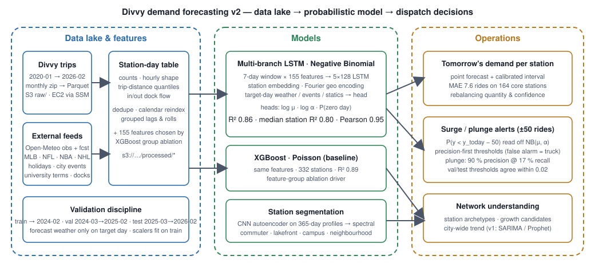
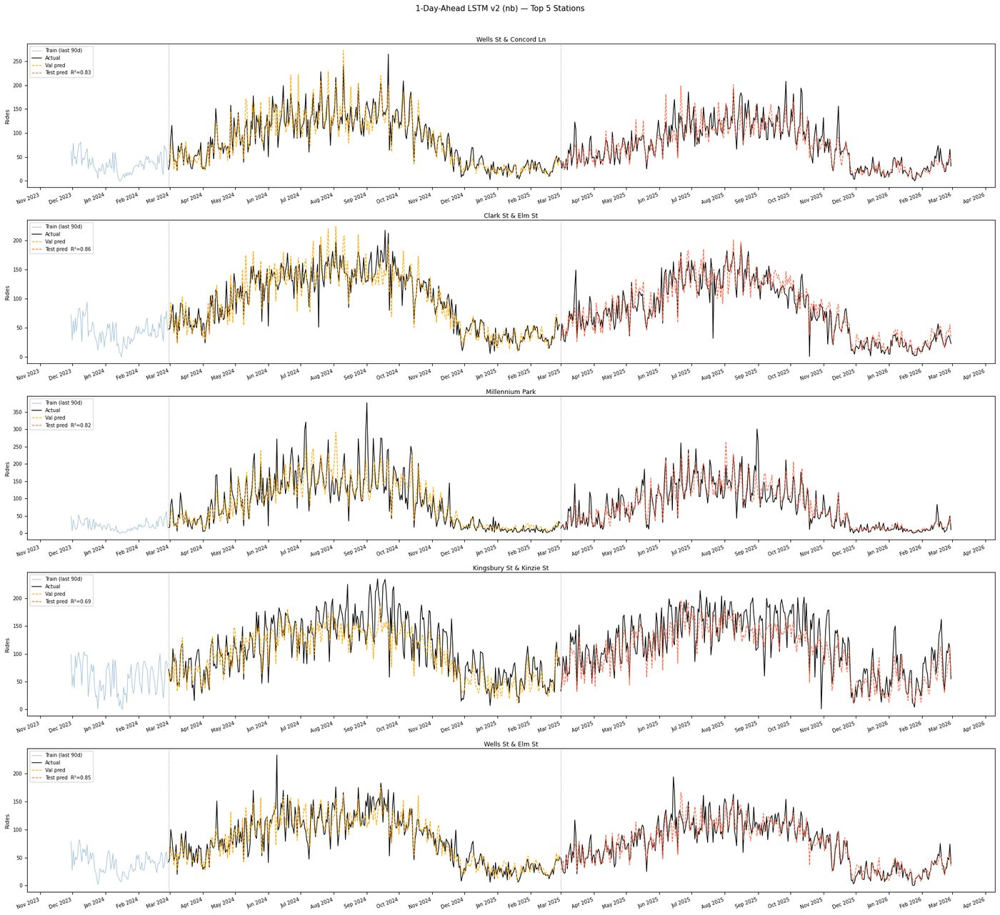
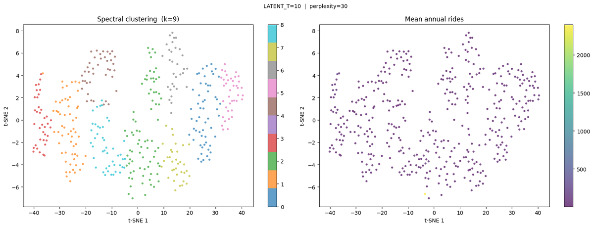
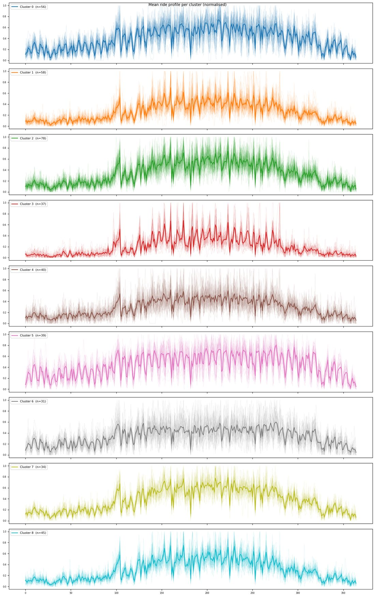
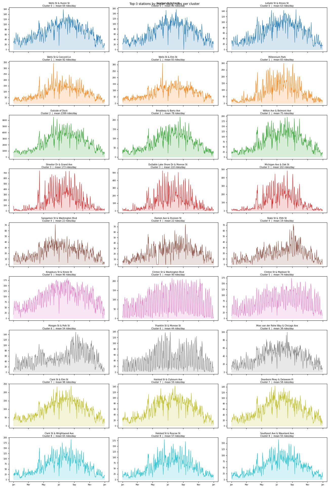
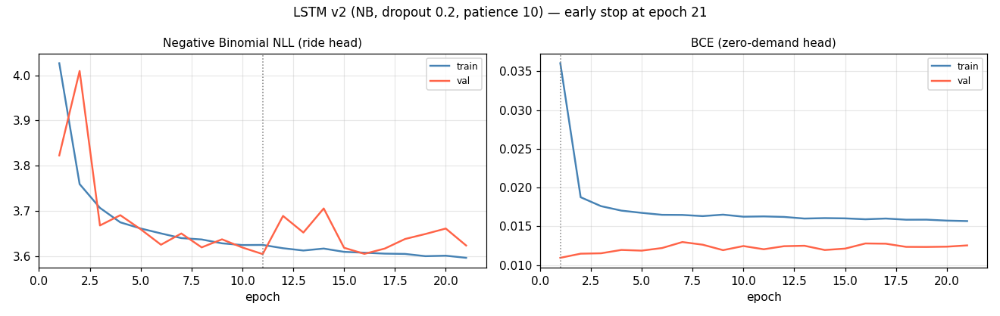

# 🚲 Forecasting Demand for Chicago's Divvy Bikeshare

Station-level demand forecasting for Chicago's Divvy system, built in two passes:

* **v1 (Jan–Mar 2025, team project)** — EDA with stationarity and Granger tests, DTW-based station segmentation,
  city-wide SARIMA/Prophet forecasts and a station-level XGBoost. Everything from that pass lives in
  [`v1/`](v1/) with its own [README](v1/README.md) and the
  [full slide deck](https://docs.google.com/presentation/d/1zirE8-RNol8iQ32XVcBCTva_F0xOp91v9OjNnADu404/edit?usp=sharing).
* **v2 (2026, this tree)** — a reproducible rebuild: S3 Parquet data lake, an ETL package with external-signal
  feeds, a feature-ablation harness, a probabilistic multi-branch LSTM, and dispatch alerts derived from its
  predictive distribution.



**Data:** every Divvy trip from 2020-01-01 to 2026-02-28 (2,249 days, ~1.4 M station-days).
**Split:** train → 2024-02-28 · val 2024-02-29 → 2025-02-28 · test 2025-03-01 → 2026-02-28.
Test uses *forecast* weather (Open-Meteo historical forecasts), never observed weather.

---

## 1 · Headline results (test year, one-day-ahead)

| Model | Stations | R² | MAE | sMAPE | Median per-station R² |
|---|---|---|---|---|---|
| XGBoost · Poisson · all features | 332 (>95 % active) | **0.894** | 5.91 | 27.5 | — |
| LSTM · Negative Binomial · all features | 332 | 0.881 | 6.35 | 31.6 | 0.746 |
| **LSTM · Negative Binomial · all features** | **164 (>99 % active)** | **0.863** | 7.58 | 27.0 | **0.795** (160/164 > 0.5) |
| LSTM · Poisson | 164 | 0.862 | 7.67 | 27.2 | 0.791 |
| LSTM · MSE | 164 | 0.833 | 8.26 | 30.0 | 0.745 |

Two things to know before reading R²:

* **Pooled R² depends on the station mix.** Adding smaller stations raises the between-station share of variance
  (28.6 % → 41.7 % of SST) and inflates pooled R² without the model getting better: the same LSTM scores 0.863 on
  164 stations and 0.881 on 332. Median per-station R² is the comparable number. On identical stations and
  features XGBoost beats the LSTM by ≈0.013 pooled R² — expected for daily tabular data with strong hand-built lags.
* **What the LSTM adds is the distribution, not the point forecast.** Under Poisson the Pearson residual std is
  1.65 (variance ≈ 2.7× the mean); the Negative Binomial model with a learned per-sample dispersion head brings it
  to **0.95–0.99**, i.e. calibrated spread. That is what makes the alerts in §3 possible.

<p align="center"></p>

---

## 2 · Station segmentation

### v1 — hierarchical clustering with Dynamic Time Warping (2021–2023)

Stations covering ≥50 % of annual rides, normalised daily series, DTW distance, agglomerative tree cut at four groups.
The four archetypes — **college campuses**, **neighbourhoods & lakefront**, **work centers**, **peripheral** — were
then given their own Prophet models (`v1/station_segmentation/`).


### v2 — learned representations (CNN autoencoder → spectral clustering)

Instead of a hand-picked distance, v2 trains a 1-D CNN autoencoder on raw 365-day ride profiles (1,301 stations,
MinMax-scaled, no calendar features) and clusters the latent space. `notebooks/clustering/station_clustering.ipynb`
compresses each station to a 10-value latent, runs spectral clustering on the 418 fully-active stations
(eigengap → k = 9) and recovers the v1 archetypes at finer grain:

| Learned cluster | Signature | Reads as | v1 archetype |
|---|---|---|---|
| 5 | sharp weekday sawtooth all year (Clinton St & Washington / Madison, Kingsbury & Kinzie) | Loop commuter | work centers |
| 3 | summer-only, weekend spikes to 500–700 rides (Streeter Dr & Grand, DuSable LSD & Monroe, Michigan & Oak) | lakefront / tourist | lakefront |
| 6 | secondary peak Sep–Nov (Morgan & Polk/UIC, Mies van der Rohe/IIT, Franklin & Monroe) | campus / semester | college campuses |
| 0 | high, flat, year-round (Wells & Huron, LaSalle & Illinois) | River North core | work centers |
| 1 · 2 · 7 · 8 | summer-peaked, mild weekly pattern, split by level and nightlife weekends (Wells & Concord, Broadway & Barry, Clark & Elm, Halsted & Roscoe) | North Side residential | neighbourhoods |
| 4 | low-volume, noisy (State & 35th, Damen & Division) | fringe | peripheral |

<p align="center">
<br>


</p>

An LSTM autoencoder (`lstm_autoencoder.ipynb`, 32-d latent) reconstructs worse (MSE 0.047 vs 0.008) and separates
less cleanly; the CNN with a temporal latent (`cnn_autoencoder_v2.ipynb`) is kept as the representation of record.
Weather-day scenarios are clustered separately (`weather_scenario.ipynb`, K-Means + a PCA weather index).

---

## 3 · Surge / plunge alerts from the predictive distribution

`P(plunge) = P(y_tomorrow < y_today − 50)` is read directly off NB(μ, α) — no extra classifier. Because a false
alarm means a truck dispatched for nothing, operating points are chosen precision-first
(`reports/nb_alert_operating_points.csv`, 164 stations, test year):

| Event (±50 rides) | Threshold | Alerts / yr | Hits | False alarms | Precision | Recall |
|---|---|---|---|---|---|---|
| Plunge | 0.95 | 72 | 69 | 3 | 0.96 | 0.13 |
| Plunge | 0.92 | 104 | 94 | 10 | **0.90** | 0.17 |
| Plunge | 0.83 | 180 | 144 | 36 | 0.80 | 0.27 |
| Surge  | 0.68 | 146 | 117 | 29 | 0.80 | 0.23 |

Val- and test-chosen thresholds agree within 0.02, so they transfer. Plunges are weather-driven and the forecast
sees them coming; surges top out near 80 % precision because many are caused by events outside the calendar.
A dedicated pos-weighted surge/plunge head was tried and lost to the distribution on AP (0.43 vs 0.51 surge,
0.36 vs 0.60 plunge) while costing 0.003 demand R².

---

## 4 · City-wide trend (v1)

SARIMA (grid-searched, seasonal period 12) and Prophet on monthly / weekly city totals pointed to a
**≈1.5 % decline in 2025 demand** after the post-COVID recovery plateau. Code in `v1/forecast/`;
the fitted Prophet model is `v1/models/prophet_weekly_citywide.pkl`.


---

## 5 · The v2 model

```
x_seq  (7 days × 155 features) ───────────────────────────────► LSTM (5 × 128, dropout 0.2) ─► h
station one-hot ─► MLP ─► 16-d station embedding ─┐                                           │
lat/lng ─► Fourier(6 bands) ─► MLP ─► 16-d geo ────┴─► concatenated onto every timestep        │
target-day inputs: 19 forecast-weather vars, 70 event/holiday/academic flags, 7 static ───────┼─► head_in
                                                                                              ▼
                                       ride_head → log μ   ·   disp_head → log α   ·   open_head → P(zero day)
loss = NB2 NLL(μ, α) + 1.0 · BCE(open)
```

* **Negative Binomial over Poisson / MSE** — same point accuracy, calibrated spread, converges in ~20 epochs
  (≈3 min on an M-series MPS) versus 40–130 for the alternatives.
* **Zero-demand auxiliary head** — only 0.7 % of station-days, yet removing it drops test R² 0.863 → 0.856.
  Its value is the gradient it sends into the trunk on exactly the days the main loss is flat, not the
  `P(open)` output itself (hurdle-style `μ · P(open)` changes nothing).
* **Correctness fixes over the first LSTM** that silently distorted lag features: duplicate station-days from
  station-ID migrations (812), zero-ride days stored as missing rows (windows and lags were row-based, not
  calendar-based), rolling statistics computed across station boundaries, val/test windows missing their first
  week, and a ReLU on the output layer. Each is documented at the top of `notebooks/forecast/lstm_forecast_v2.ipynb`.

<p align="center"></p>

### Features (selected by XGBoost ablation — `scripts/validate_features_xgb.py`, `reports/feature_ablation.csv`)

| Group | Columns | Δ test R² alone |
|---|---|---|
| Weather | all 19 Open-Meteo daily variables; observed in the window, forecast on the target day | **+0.015** |
| Holidays | US federal + Illinois, major, eve/after/bridge days, Christmas week | **+0.009** |
| City events | 16 events (Marathon, Lollapalooza, Pride, NASCAR, …) × exp(−d/1.5 km) distance decay | +0.004 |
| Sports | Cubs / White Sox / Bears / Bulls / Blackhawks home games, day game, playoff, × distance decay | +0.002 |
| Academic | nearest university in session, term week, finals, remote | +0.001 |
| Station meta | dock capacity, charging station, canonical name (aliases merged) | +0.001 |
| Dock flow | yesterday's inbound / net flow, 7-day net flow, inbound e-bike share | −0.003 alone; `inbound_lag1` is #3 by gain in the full model |
| Calendar | Fourier day-of-year / weekday, station × weekday 52-week profile | −0.003 alone, useful in combination |
| Within-day shape | 24 hourly ride fractions, round-trip share, trip-distance quantiles (30-day lagged means) | from v1 |
| Autoregressive | lags 30/60/90/365, rolling 7/30-day stats, 365-day e-bike & member share | from v1 |

All groups together: XGBoost test R² 0.871 → 0.894. Game-day attendance and a linear trend were dropped —
attendance is only known after the game, and the trend extrapolates past the training range.
An event-day F-test on city totals (`notebooks/eda_prep/event_feature_regression.ipynb`) motivated the sports
feed before any model was trained: F = 38.5, p ≈ 1e-30 on top of calendar, weather and lag controls.

---

## 6 · Repository layout

```
src/divvy_demand/
  infra/        S3Client (Parquet lake: raw/ridership/year=/month=, processed/*), EC2Runner (SSM, no SSH)
  etl.py        overall / station (with within-day shape) / trip / station_flow tables
  weather.py    Open-Meteo observed + historical-forecast feeds
  sports.py     MLB (pybaseball), NFL (nfl_data_py), NBA (nba_api), NHL (public API) home schedules
  holidays.py · academic.py · calendars/   holiday, city-event and university-term calendars
  station_meta.py · features.py           station canonicalisation, Fourier calendar, event × distance, DOW profile
scripts/
  ingest.py              monthly Divvy zip → Parquet in S3
  run_etl.py             build every processed table
  run_ec2_etl.py         ship src/ to EC2 via S3 and run the ETL there
  validate_features_xgb.py   feature-group ablation with XGBoost Poisson
notebooks/
  eda_prep/      stationarity, weather × ridership, event F-test, inventory estimation
  clustering/    CNN / LSTM autoencoders over 365-day profiles, weather-scenario KMeans + PCA index
  forecast/      xgboost.ipynb · xgboost_poisson.ipynb · model_evaluation.ipynb · lstm_forecast.ipynb (first LSTM)
                 lstm_forecast_v2.ipynb  ← current model, changelog, ablations and alert tables
reports/         feature_ablation*.csv, nb_alert_operating_points.csv, figures/
v1/              the 2025 project as it was: Data ETL/, station_segmentation/, forecast/, models/, README.md
```

## 7 · Reproducing

```bash
pip install -e .                      # Python 3.11; torch + xgboost + scikit-learn are needed for the notebooks
cp .env.example .env                  # AWS credentials, bucket, EC2 instance id
python scripts/ingest.py              # raw trips → s3://<bucket>/divvy/prod/raw/ridership/
python scripts/run_etl.py             # processed tables (station, weather, events, station_flow, …)
python scripts/validate_features_xgb.py   # optional: regenerate reports/feature_ablation.csv
```

Then run `notebooks/forecast/lstm_forecast_v2.ipynb` top to bottom (`LOSS_MODE` switches `nb` / `poisson` / `mse`).
Trained weights (`models/*.pt`, `models/xgb_*.json`) are not committed; every notebook writes its own.

## 8 · Known limits / next

* One-day horizon only; multi-day needs recursive rollout or retraining.
* Covers the 332 stations active on >95 % of days; the long tail of small stations is out of scope.
* Surge precision is capped by event-calendar coverage, not model capacity — extending the city-event feed is the
  cheapest route to better surge alerts.
* An XGBoost + LSTM blend has not been evaluated; their errors are plausibly complementary.
